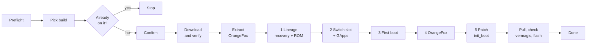

# oneplus-dodge-updater

Tooling and notes for keeping a [OnePlus 13](https://en.wikipedia.org/wiki/OnePlus_13) (CPH2655, codename `dodge`) on the latest LineageOS nightly with MindTheGapps, OrangeFox and KernelSU-Next. A same-major update keeps data; back up before a major jump (e.g. 24 to 25).

Two front ends run the same update sequence: a PowerShell script, and **Dodge Toolbox**, a Rust (Tauri) Windows app with one button per step and a live log. Both read downloads from a data root outside the repo. The full reference (every option, the manual flash steps and known issues) is in [`docs/reference.md`](docs/reference.md).

## Contents

```
scripts/
  update-lineage.ps1        scripted update (the flow below)
  build-toolbox.ps1         builds the Toolbox, copies "Dodge Toolbox <version>.exe" to the repo root
toolbox/                    Tauri app: Rust in src/ (steps in toolbox.rs), page in ui/ (step list in renderer.js),
                            build.rs fetches the pinned theme (theme.json)
.claude/skills/update-lineageos/   Claude skill for running an update
docs/reference.md           full reference: options, Toolbox usage, manual flash, known issues
docs/audit-findings-*.md    audit work list
.env.example                copy to .env to set DODGE_DATA_ROOT / DODGE_PLATFORM_TOOLS

<DODGE_DATA_ROOT>/          default X:\Android Development\Devices\Dodge (not in git)
  artifacts/
    builds/<major>-<date>/  recovery.img, init_boot.img, build-manifest.xml
    lineage/ mindthegapps/ orangefox/ kernelsu-next/   zips and APKs
    fox-extract/            unzipped OrangeFox recovery.img
    images/                 patched init_boot images, loose images
    archives/               other downloaded bundles
  platform-tools/           adb / fastboot
```

## Quick start

Needs Windows, PowerShell, the latest [Android SDK Platform-Tools](https://developer.android.com/tools/releases/platform-tools) (old adb 1.0.39 can fail on the 3 GB sideload), USB debugging authorized and an unlocked bootloader. The script wants `adb`/`fastboot` on `PATH`. The Toolbox also needs [Rust](https://rustup.rs) (MSVC toolchain) and a network connection on the first build, for the theme.

```powershell
Copy-Item .env.example .env                          # then set DODGE_DATA_ROOT if not the X: default
powershell -File scripts\update-lineage.ps1          # scripted update
cd toolbox; cargo run                                # or the Toolbox in dev mode, one button per step
pwsh scripts\build-toolbox.ps1                       # build the portable exe
cargo test --manifest-path toolbox/Cargo.toml        # unit tests (CI uses --profile fast)
```

LineageOS docs for the device: [device page](https://wiki.lineageos.org/devices/dodge/), [install](https://wiki.lineageos.org/devices/dodge/install/), [upgrade](https://wiki.lineageos.org/devices/dodge/upgrade/) (check it for required wipes on a major jump), [nightlies](https://download.lineageos.org/devices/dodge/builds).

## Update flow



| Step | What happens |
| --- | --- |
| Preflight | `adb`/`fastboot` found and an authorized device connected; reads the installed build and kernel. |
| Pick build | Newest nightly from the LineageOS API (or `-Build`). Stops if already on it; a major version change only warns. |
| Confirm | One prompt before anything is downloaded or flashed. |
| Download and verify | ROM zip (SHA-256 from the API), `recovery.img` (must be 104857600 bytes), `init_boot.img`, `build-manifest.xml`. Existing files are skipped. |
| Extract OrangeFox | Unzips OrangeFox's `recovery.img` to `artifacts\fox-extract` and checks its size. |
| 1. Lineage recovery + ROM | Flashes LineageOS Recovery, then sideloads the ROM (tap **Apply from ADB**; stopping near 47% is normal). |
| 2. Switch slot + GApps | **Reboot to recovery** to land on the new slot, then sideload MindTheGapps (answer Yes to the signature warning). |
| 3. First boot | Reboots to system once and waits for `sys.boot_completed`. |
| 4. OrangeFox | Flashes OrangeFox last, since the ROM zip can overwrite the recovery. |
| 5. Patch init_boot | Pushes the new `init_boot.img`; you patch it in KernelSU-Next, choosing KMI `android15-6.6` by hand. |
| Pull, check, flash | Pulls the patched image, rejects it unless `vermagic=` is 6.6.x, flashes it and reboots; the manager should say **Working**. |

`init_boot` is replaced on every update, so KernelSU-Next is re-patched each time. The Toolbox has the same steps from **Pick build** on (**Refresh** does the preflight) and asks before each step that reboots or flashes instead of one confirm up front.

## Scripts

**`scripts\update-lineage.ps1`** runs the flow above. Steps that need a tap on the phone pause until you press Enter. Options: `-Build yyyyMMdd`, `-DataRoot` (default `DODGE_DATA_ROOT` from the environment or `.env`, else the X: store; throws if missing), `-Device`, `-Gapps`, `-FoxZip`, `-KsuPackage`. The patched image is saved as `artifacts\images\ksu-patched-init_boot-<date>.img`; to roll back root, flash `artifacts\builds\<major>-<date>\init_boot.img` to `init_boot`.

**`scripts\build-toolbox.ps1`** runs `cargo build` into `%LOCALAPPDATA%\dodge-toolbox-target` and copies `Dodge Toolbox <version>.exe` to the repo root. `-Fast` skips LTO (quicker, larger exe), `-BumpTheme` pins the newest theme first, and it stops if its `-Store` folder (default the X: data root) is missing.

**Configuration:** copy `.env.example` to `.env` (gitignored). `DODGE_DATA_ROOT` is where `artifacts\` and `platform-tools\` live; `DODGE_PLATFORM_TOOLS` optionally overrides the platform-tools folder. Real environment variables win over the file.

Full parameter tables are in [docs/reference.md](docs/reference.md#scripts).

## Dodge Toolbox

A Windows app that runs the update one button at a time with a live log, written in Rust with [Tauri](https://tauri.app). The page in `toolbox\ui\` is drawn by the WebView2 runtime that ships with Windows 10/11 rather than a bundled Chromium, so the exe is a few MB; `toolbox\src\` does the phone, network and disk work.

**Theme.** The shared [yl-theme](https://github.com/AardeYamz/yl-theme) files (`ui/theme/yl-theme.css`, `yl-theme.js`, `favicon.svg`) are not committed. Every build runs `build.rs`, which downloads the version pinned in `toolbox/theme.json` from https://theme.yannislam.org, checks each file's SHA-256 and renders the window/exe icon from `favicon.svg`. `build-toolbox.ps1 -BumpTheme` pins the newest version; `DODGE_SKIP_THEME=1` builds without it, for offline compile checks only.

**Building the exe.** Use `pwsh scripts\build-toolbox.ps1` (gives `Dodge Toolbox <version>.exe` in the repo root), or `cargo build --release` in `toolbox\` (gives `toolbox\target\release\dodge-toolbox.exe`). A release exe looks for `scripts\` and `.env` next to itself, so keep it in the repo root or set the app folder in Settings. Settings are kept in `%APPDATA%\Dodge Toolbox\settings.json`.

**Using it.**

1. Open **Settings** and check the data folder and platform-tools folder. The header shows the adb version.
2. Click **Refresh** to see the phone's state (`device`, `sideload`, `fastboot`...), build, kernel and slot.
3. Run the steps top to bottom. Yellow boxes say what to tap on the phone *before* clicking Run; steps that reboot or flash ask first.

**Cancel** stops the running command, download or wait. **Quick actions** has reboot buttons, a box for one-off `adb`/`fastboot` commands (wipe commands such as `fastboot -w`, `erase userdata`, `format` and `wipe` are refused) and a button that opens the update script in PowerShell.

## Manual flash

The script and the Toolbox automate the manual steps, which are written out in full, with every command, in [docs/reference.md](docs/reference.md#manual-flash-instructions). In short:

0. Extract OrangeFox's `recovery.img` to its own folder and check it is 104857600 bytes.
1. In LineageOS Recovery, **Apply from ADB** and sideload the ROM (wipe only when coming from OxygenOS).
2. **Advanced -> Reboot to recovery** to switch slot. Do not boot to system yet.
3. Sideload MindTheGapps (its version must match the Android version of the build).
4. Boot to system once and check it works.
5. Flash OrangeFox with `fastboot flash recovery` (not `fastboot boot`, which fails on this phone).
6. Patch `init_boot.img` in the KernelSU-Next manager with KMI **android15-6.6** (the auto pick is wrong), flash it to `init_boot` and check the manager says **Working**. The stock `init_boot.img` is the backup.

Always call `.\platform-tools\adb.exe` / `fastboot.exe` explicitly so an older adb on `PATH` is not used, and never run `fastboot -w`, `erase userdata` or "Format data" unless you mean to wipe the phone. See [Known issues](docs/reference.md#known-issues).

## Related repos

| Repo | Relationship |
|---|---|
| [yl-theme](https://github.com/AardeYamz/yl-theme) | Theme for the Toolbox UI, pinned by version and SHA-256 in `toolbox/theme.json` and fetched from theme.yannislam.org by `build.rs` |
| [personal-domain-devops](https://github.com/AardeYamz/personal-domain-devops) | Defines a self-hosted runner for this repo (`runner/compose.yml`); `build.yml` on `main` still runs on GitHub-hosted `windows-latest` |
| [personal-server](https://github.com/AardeYamz/personal-server) | Home server that hosts those runner containers (`docs/runbook.md`) |
| [workflows](https://github.com/AardeYamz/workflows) | Shared reusable workflows and the mermaid linter; no workflow here calls it yet |
