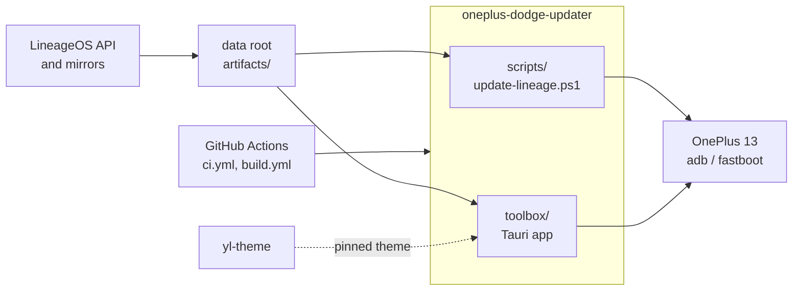

# oneplus-dodge-updater

[](https://github.com/AardeYamz/oneplus-dodge-updater/actions/workflows/ci.yml)
[](https://github.com/AardeYamz/oneplus-dodge-updater/actions/workflows/build.yml)


Private. Keeps a [OnePlus 13](https://en.wikipedia.org/wiki/OnePlus_13) (CPH2655, `dodge`) on the latest LineageOS nightly with MindTheGapps, OrangeFox and KernelSU-Next, from a PowerShell script or **Dodge Toolbox**, a Windows app with one button per step.

## Architecture



- **Flow:** pick the newest build, confirm, download and verify, sideload LineageOS, switch slot, sideload MindTheGapps, boot once, flash OrangeFox, then patch and flash `init_boot` (replaced by every update).
- **Safety:** flashing is refused unless exactly one device is attached and it is the dodge. A same-major update keeps data; back up before a major jump and check the [upgrade guide](https://wiki.lineageos.org/devices/dodge/upgrade/) for wipes.
- **Data root:** downloads and `platform-tools\` live outside the repo, set by `DODGE_DATA_ROOT` in `.env` (see `.env.example`).
- **Theme:** `build.rs` downloads the [yl-theme](https://github.com/AardeYamz/yl-theme) version pinned in `toolbox/theme.json` and checks each SHA-256. `DODGE_SKIP_THEME=1` skips it for offline compile checks.

## Layout

```
scripts/            update-lineage.ps1, build-toolbox.ps1, shared helpers and their tests
toolbox/            Tauri app: Rust in src/, page in ui/
.claude/skills/     Claude skill for running an update
docs/               audit findings
.github/            CI, build and Dependabot config
```

## Related repos

| Repo | Role |
|---|---|
| [yl-theme](https://github.com/AardeYamz/yl-theme) | theme for the Toolbox UI |
| [workflows](https://github.com/AardeYamz/workflows) | shared CI workflows |
| [personal-domain-devops](https://github.com/AardeYamz/personal-domain-devops) | self-hosted runner definition |
| [personal-server](https://github.com/AardeYamz/personal-server) | hosts the runners |

## Commands

Needs Windows, PowerShell, current [Platform-Tools](https://developer.android.com/tools/releases/platform-tools) on `PATH` (adb 1.0.39 can fail on the ROM sideload), USB debugging and an unlocked bootloader. The Toolbox also needs [Rust](https://rustup.rs) (MSVC).

```powershell
Copy-Item .env.example .env                             # set DODGE_DATA_ROOT
powershell -File scripts\update-lineage.ps1             # scripted update; -Build yyyyMMdd for a given nightly
cd toolbox; cargo run; cd ..                            # Toolbox in dev mode
pwsh scripts\build-toolbox.ps1                          # portable exe; -Fast, -BumpTheme
cargo test --manifest-path toolbox/Cargo.toml           # unit tests
pwsh scripts\test-helpers.ps1                           # script helper tests
```

### Manual flash

All files must be from the same build, under `artifacts\`. MindTheGapps must match its Android version.

0. Extract OrangeFox's `recovery.img` to `artifacts\fox-extract\`; it must be 104857600 bytes.
1. `adb reboot bootloader`, `fastboot flash recovery <build>\recovery.img` (LineageOS Recovery), `fastboot reboot recovery`.
2. Phone: **Apply from ADB**, then `adb sideload <lineage zip>` (stopping near 47% is normal). Wipe only when coming from OxygenOS.
3. Phone: **Advanced > Reboot to recovery** to switch slot (do not boot the system yet), **Apply from ADB**, `adb sideload <gapps zip>`, answer **Yes** to the signature warning.
4. Reboot to system once and check it works.
5. `adb reboot bootloader`, `fastboot flash recovery artifacts\fox-extract\recovery.img`. Use `flash`: `fastboot boot` fails on this phone.
6. `adb push <build>\init_boot.img /sdcard/Download/`, patch it in KernelSU-Next choosing KMI **android15-6.6** by hand (the auto pick is wrong), `adb pull` it, `fastboot flash init_boot <patched>`. The manager should say **Working**. Undo: flash the stock `init_boot.img`.

Never run `fastboot -w`, `fastboot erase userdata` or "Format data" unless you mean to wipe the phone.

## Docs

- [LineageOS dodge wiki](https://wiki.lineageos.org/devices/dodge/): [install](https://wiki.lineageos.org/devices/dodge/install/), [upgrade](https://wiki.lineageos.org/devices/dodge/upgrade/), [nightlies](https://download.lineageos.org/devices/dodge/builds).
- [docs/audit-findings-2026-11-09.md](docs/audit-findings-2026-11-09.md): audit work list.
