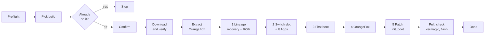

# oneplus-dodge-updater

Tooling and notes for keeping a [OnePlus 13](https://en.wikipedia.org/wiki/OnePlus_13) (CPH2655, codename `dodge`) on the latest LineageOS nightly with MindTheGapps, OrangeFox and KernelSU-Next. A same-major update keeps data; back up before a major jump (e.g. 24 to 25).

## Architecture

Two front ends run the same update sequence: a PowerShell script, and **Dodge Toolbox**, a Rust (Tauri) Windows app with one button per step, an autorun and a live log. Both read downloads from a data root outside the repo.



The script follows this order exactly. The Toolbox has the same steps from **Pick build** on (Refresh does the preflight), and asks before each step that reboots or flashes instead of one confirm up front. A major version change only warns.

| Path | What |
|---|---|
| `scripts/update-lineage.ps1` | the scripted update (the sequence above) |
| `scripts/build-toolbox.ps1` | builds the toolbox and copies `Dodge Toolbox <version>.exe` to the repo root |
| `toolbox/` | the Tauri app: Rust in `src/` (steps in `toolbox.rs`), page in `ui/` (step list in `renderer.js`), `build.rs` fetches the pinned theme |
| `.claude/skills/update-lineageos/` | Claude skill for running an update |
| [`docs/reference.md`](docs/reference.md) | script options, Toolbox usage, manual flash instructions, known issues |
| `docs/audit-findings-*.md` | audit work list |
| `.env.example` | `DODGE_DATA_ROOT` (where `artifacts\` and `platform-tools\` live, default `X:\Android Development\Devices\Dodge`) and optional `DODGE_PLATFORM_TOOLS`; copy to `.env` |

## Related repos

| Repo | Relationship |
|---|---|
| [yl-theme](https://github.com/AardeYamz/yl-theme) | Theme for the Toolbox UI, pinned by version and SHA-256 in `toolbox/theme.json` and fetched from theme.yannislam.org by `build.rs` |
| [personal-domain-devops](https://github.com/AardeYamz/personal-domain-devops) | Defines a self-hosted runner for this repo (`runner/compose.yml`); `build.yml` on `main` still runs on GitHub-hosted `windows-latest` |
| [personal-server](https://github.com/AardeYamz/personal-server) | Home server that hosts those runner containers (`docs/runbook.md`) |
| [workflows](https://github.com/AardeYamz/workflows) | Shared reusable workflows and the mermaid linter; no workflow here calls it yet |

## Key commands

Needs Windows, PowerShell, the latest [Android SDK Platform-Tools](https://developer.android.com/tools/releases/platform-tools) (old adb 1.0.39 can fail on the 3 GB sideload), USB debugging authorized and an unlocked bootloader. The Toolbox also needs [Rust](https://rustup.rs) (MSVC) and a network connection on the first build for the theme.

```powershell
powershell -File scripts\update-lineage.ps1        # scripted update (-Build yyyyMMdd, -DataRoot ...)
cd toolbox; cargo run                               # Toolbox in dev mode
cargo test --manifest-path toolbox/Cargo.toml       # unit tests (CI uses --profile fast)
pwsh scripts\build-toolbox.ps1 [-Fast] [-BumpTheme] # portable exe in the repo root
```

`build-toolbox.ps1` stops if its `-Store` folder (default the X: data root) is missing.

LineageOS docs for the device: [device page](https://wiki.lineageos.org/devices/dodge/), [install](https://wiki.lineageos.org/devices/dodge/install/), [upgrade](https://wiki.lineageos.org/devices/dodge/upgrade/), [nightlies](https://download.lineageos.org/devices/dodge/builds).
