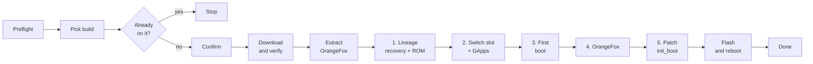

# dodge

Tooling and notes for keeping the OnePlus 13 (CPH2655, codename `dodge`) on the latest LineageOS nightly with MindTheGapps, OrangeFox and KernelSU-Next.

## Contents

```
scripts/     update-lineage.ps1 (scripted update), build-toolbox.ps1 (builds the exe)
toolbox/     Electron app that runs the update steps with a live log
artifacts/   downloads and flash images (gitignored; keep it on any drive and link it in, see `DODGE_DATA_ROOT`)
  builds/<major>-<date>/   recovery.img, init_boot.img, build-manifest.xml
  lineage/ mindthegapps/ orangefox/ kernelsu-next/   zips and APKs
  fox-extract/             unzipped OrangeFox recovery.img
  images/                  patched init_boot images, loose images
  archives/                other downloaded bundles
platform-tools/             adb / fastboot (gitignored; same data folder, linked in)
```

## Quick start

```powershell
powershell -File scripts\update-lineage.ps1      # scripted update
cd toolbox; npm install; npm start               # or the toolbox app, one button per step
pwsh scripts\build-toolbox.ps1                   # build the portable exe
```

Prerequisites: Windows, PowerShell, `adb`/`fastboot` (platform-tools) on `PATH` (not the old Essential ADB 1.0.39, which fails on the 3 GB zip), USB debugging authorized, bootloader unlocked. Node.js 20+ for the toolbox.

A same-major update keeps data. Back up before a major jump (e.g. 24 -> 25).

LineageOS documentation for this device:

- [Device page (dodge)](https://wiki.lineageos.org/devices/dodge/)
- [Install guide](https://wiki.lineageos.org/devices/dodge/install/)
- [Upgrade guide](https://wiki.lineageos.org/devices/dodge/upgrade/) (check it for required wipes on a major jump)
- [Nightly builds](https://download.lineageos.org/devices/dodge/builds)

## Update flow



| Step | What happens |
| --- | --- |
| Preflight | Checks `adb`/`fastboot` are on `PATH` and an authorized device is connected; reads the installed build and kernel. |
| Pick build | Queries the LineageOS API for the newest nightly (or `-Build`). Stops if the phone is already on it; warns on a major version change. |
| Confirm | Asks before anything is downloaded or flashed. |
| Download and verify | Fetches the ROM zip, `recovery.img`, `init_boot.img` and `build-manifest.xml`; checks the zip's SHA-256 and the `recovery.img` size. |
| Extract OrangeFox | Unzips OrangeFox's `recovery.img` into `fox-extract` and checks its size. |
| 1. Lineage recovery + ROM | Flashes LineageOS Recovery, then sideloads the ROM (tap **Apply from ADB** first). |
| 2. Switch slot + GApps | Reboots to recovery to land on the new slot, then sideloads MindTheGapps. |
| 3. First boot | Reboots to system once and waits for boot to complete. |
| 4. OrangeFox | Flashes the OrangeFox recovery (last, since the ROM zip can overwrite the recovery). |
| 5. Patch init_boot | Pushes the new `init_boot.img`; you patch it in KernelSU-Next with KMI `android15-6.6`; the script pulls it and checks `vermagic=` is 6.6.x. |
| Flash and reboot | Flashes the patched `init_boot`, reboots, and you confirm the manager says **Working**. |

`init_boot` is replaced on every update, so KernelSU-Next is re-patched each time.

## Scripts

### `scripts\update-lineage.ps1`

Scripted version of the [manual flash instructions](#manual-flash-instructions). Steps that need a tap on the phone pause until you press Enter; the update and each wipe-risk step ask first.

| Parameter | Default | What it does |
| --- | --- | --- |
| `-Build` | newest nightly | Build date to install (`yyyyMMdd`), matched against the LineageOS API response. |
| `-DataRoot` | `$env:DODGE_DATA_ROOT`, then `DODGE_DATA_ROOT` in `.env`, then the script's built-in default store folder | Folder holding `artifacts\`. Throws if it does not exist. |
| `-Device` | `dodge` | LineageOS device codename used for the API and mirror URLs. |
| `-Gapps` | the pinned zip in `<DataRoot>\artifacts\mindthegapps\` | MindTheGapps zip to sideload. |
| `-FoxZip` | the pinned zip in `<DataRoot>\artifacts\orangefox\` | OrangeFox zip; `recovery.img` is extracted to `artifacts\fox-extract`. |
| `-KsuPackage` | `com.rifsxd.ksunext` | KernelSU-Next manager package name shown in the on-phone prompt. |

Behavior:

- Stops if already on the target build; warns on a major version change.
- Downloads are skipped when the file already exists. The ROM zip is checked against the API SHA-256, and `recovery.img` must be exactly 104857600 bytes (same check for OrangeFox).
- Patched `init_boot` is saved as `artifacts\images\ksu-patched-init_boot-<date>.img` and rejected unless its `vermagic=` is 6.6.x.
- Rollback for root: `fastboot flash init_boot artifacts\builds\<major>-<date>\init_boot.img`.

### `scripts\build-toolbox.ps1`

Builds the portable Toolbox exe.

| Parameter | Default | What it does |
| --- | --- | --- |
| `-Store` | the same built-in default store folder | Data store. Build output goes to `<Store>\toolbox-dist`; throws if the folder is missing. |

It runs `npm ci` if `node_modules` is missing, fetches the theme, runs electron-builder (portable, Windows), and copies `Dodge Toolbox <version>.exe` to the repo root. Keep the exe there so it finds `artifacts\` and `scripts\`.

### Configuration

Copy `.env.example` to `.env` (gitignored). Real environment variables win over the file.

| Variable | What it does |
| --- | --- |
| `DODGE_DATA_ROOT` | Where `artifacts\` and `platform-tools\` live. |
| `DODGE_PLATFORM_TOOLS` | Optional override for the platform-tools folder (default `<DODGE_DATA_ROOT>\platform-tools`). |

## Dodge Toolbox

An Electron app (Windows) that runs the same sequence one button at a time, with a live log.

```powershell
cd toolbox
npm install
npm start
```

The shared theme (`theme/yl-theme.css`, `theme/yl-theme.js`) is not committed. `npm start` and `npm run dist` first run `fetch-theme.js`, which downloads the version pinned in `theme.json` from https://theme.yannislam.org and checks its SHA-256 (needs a network connection the first time). `npm run theme` does it alone; `node fetch-theme.js --bump` pins the newest version. `theme/yl-fonts.css` is licensed and stays in the repo.

To build a single portable `.exe`: `npm run dist` (output in `toolbox\dist\`), or use `scripts\build-toolbox.ps1` as above. Set the working folder in Settings if the exe is not in the repo root.

Use:

1. Open **Settings** and check the platform-tools folder. The header shows the adb version and warns if the old Essential ADB (1.0.39) is in use.
2. Click **Refresh** to see the phone's state (`device`, `sideload`, `fastboot`...), build, kernel and slot.
3. Run the steps top to bottom. Yellow boxes say what to tap on the phone *before* clicking Run. Steps that reboot or flash ask first.

**Cancel** stops the running command, download or wait. **Quick actions** has reboot buttons, a box for one-off `adb`/`fastboot` commands, and a button that opens `scripts\update-lineage.ps1` in a PowerShell window. Wipe commands (`fastboot -w`, `erase userdata`, `format`, `wipe`) are refused in the command box.

Not yet run end to end against the phone.

## Manual flash instructions

Status: working draft, not yet confirmed end to end. These are the steps `update-lineage.ps1` and the toolbox automate. In the examples, `<major>-<date>` is the build folder, e.g. the LineageOS major version and the build date.

Run from the repo root in PowerShell with `platform-tools` linked in. Always put `.\platform-tools\` in front of `adb.exe` and `fastboot.exe`: plain `adb` picks up the old Essential ADB (1.0.39), which fails on the 3 GB zip.

Files (all builds must match), under `artifacts\`:

- `builds\<major>-<date>\` and `lineage\lineage-<version>-<date>-nightly-dodge-signed.zip`
- `mindthegapps\MindTheGapps-<version>-arm64-<stamp>.zip` (the version must match the Android version of the LineageOS build)
- `orangefox\OrangeFox-<version>-dodge.zip` (the newest release for `dodge` from the [OrangeFox download page](https://orangefox.download/device/dodge))

Order: LineageOS, then MindTheGapps, then OrangeFox last. The LineageOS zip can overwrite the recovery, so OrangeFox goes on last.

### 0. Prepare OrangeFox's recovery.img (once)

Download the zip from the [OrangeFox download page for dodge](https://orangefox.download/device/dodge); see the [OrangeFox installation guide](https://wiki.orangefox.tech/en/guides/installing_orangefox) for the general procedure.

Extract into its own folder so it doesn't overwrite LineageOS's `recovery.img`:

```powershell
Expand-Archive "artifacts\orangefox\OrangeFox-<version>-dodge.zip" -DestinationPath "artifacts\fox-extract" -Force
(Get-Item "artifacts\fox-extract\recovery.img").Length
```

The size must print `104857600`. If not, the extraction was cut short; do not flash it.

### 1. Install LineageOS (from LineageOS Recovery)

No wipe if you're upgrading from an earlier LineageOS. Wipe (Factory reset) only when coming from OxygenOS.

On the phone: **Apply update -> Apply from ADB**.

```powershell
.\platform-tools\adb.exe devices
.\platform-tools\adb.exe sideload "artifacts\lineage\lineage-<version>-<date>-nightly-dodge-signed.zip"
```

`devices` must list the phone as `sideload`. Stopping at about 47% with `Total xfer: 1.00x` is normal. Wait for the phone to say it finished.

### 2. Switch slot

Do not reboot to system yet. On the phone: **Advanced -> Reboot to recovery**. This puts you on the slot LineageOS was installed to, so the GApps go to the right place.

### 3. Install MindTheGapps

On the phone: **Apply update -> Apply from ADB**.

```powershell
.\platform-tools\adb.exe devices
.\platform-tools\adb.exe sideload "artifacts\mindthegapps\MindTheGapps-<version>-arm64-<stamp>.zip"
```

When recovery says it can't verify the signature, choose **Yes**. That's expected.

### 4. Boot into the system once

Tap **Reboot system now**. The first boot can take several minutes. Confirm LineageOS and Google apps work before continuing.

### 5. Install OrangeFox (last)

```powershell
.\platform-tools\adb.exe reboot bootloader
.\platform-tools\fastboot.exe devices
.\platform-tools\fastboot.exe flash recovery artifacts\fox-extract\recovery.img
.\platform-tools\fastboot.exe reboot recovery
```

This replaces LineageOS Recovery with OrangeFox and keeps your data. If it doesn't land in OrangeFox, use the volume keys in the bootloader menu to pick **Recovery mode**.

To go back to LineageOS Recovery: `.\platform-tools\fastboot.exe flash recovery artifacts\builds\<major>-<date>\recovery.img`

### 6. Install KernelSU-Next (LKM, patch init_boot)

Use the [latest KernelSU-Next release](https://github.com/KernelSU-Next/KernelSU-Next/releases/latest). Needs a GKI kernel. LineageOS must already be installed and booting. The "installation" page on kernelsu-next.github.io is for building into kernel source; it does not apply here.

1. Check the kernel: `.\platform-tools\adb.exe shell uname -r`. This phone reports `6.6.x-4k-...`, so the KMI is **android15-6.6**. If the kernel is not GKI, stop.
2. Download the manager APK `KernelSU_Next_v<version>_<build>-release.apk` (not the "spoofed" one; see below) from the release page (saved in `artifacts\kernelsu-next\`).
3. Install it and push the `init_boot.img` from the same LineageOS build:
   ```powershell
   .\platform-tools\adb.exe install "artifacts\kernelsu-next\KernelSU_Next_v<version>_<build>-release.apk"
   .\platform-tools\adb.exe push "artifacts\builds\<major>-<date>\init_boot.img" /sdcard/Download/
   ```
4. In the manager: **Install -> Select and patch a file** -> pick `init_boot.img`.
   **Choose the KMI manually: `android15-6.6`.** The manager auto-picks by Android version, so on Android 17 it chose `android17-6.18`. That module can't load on a 6.6 kernel, and the manager then says "not installed, click to install".
5. Pull the patched image (use the filename the manager shows, one per KMI you patch):
   ```powershell
   .\platform-tools\adb.exe pull /sdcard/Download/<patched-file>.img artifacts\images\ksu-patched-init_boot.img
   ```
   Optional check that the embedded module matches the kernel: search the image for the `vermagic=` string. The right one reads `vermagic=6.6.x-4k...`. A 6.12 or 6.18 value is the wrong KMI.
6. Flash it:
   ```powershell
   .\platform-tools\adb.exe reboot bootloader
   .\platform-tools\fastboot.exe flash init_boot artifacts\images\ksu-patched-init_boot.img
   .\platform-tools\fastboot.exe reboot
   ```
7. Open the manager. It should show **Working**. The module only needs to match the kernel's KMI, not the exact 6.6.x patch level.

Backup/undo: the original `artifacts\builds\<major>-<date>\init_boot.img` is the backup. To undo, flash it back with `fastboot flash init_boot`. After every LineageOS update, `init_boot` is replaced, so repeat steps 4-6 with the new build's `init_boot.img`.

Result: KernelSU-Next (LKM, android15-6.6) confirmed working. Saved files in `artifacts\kernelsu-next\`: the APK, the working patched image, and the stock backup.

Tried the "spoofed" manager APK (installs under a random package name) to see if it would hide from detectors on its own: it did not work. The kernel module (flashed in step 6) only recognizes the original manager's app signature, so the spoofed build showed "Not installed" even after re-patching and reflashing with it. Reverted to the original manager, which still shows Working. Uninstalled the spoofed APK.

### Known issues

- `fastboot boot artifacts\fox-extract\recovery.img` transferred the image but failed with `usb_read failed ... (31)`. Use `fastboot flash recovery` instead (step 5).
- Mind the build folder name: use the full `<major>-<date>`, not a truncated date.
- Don't run `fastboot -w`, `fastboot erase userdata`, or "Format data" in recovery unless you mean to wipe the phone.
- KernelSU-Next says "not installed" after flashing: the patch used the wrong KMI (auto-picked `android17-6.18`). Re-patch with `android15-6.6` and reflash (step 6).
- adb has no root on this device (`su` is inaccessible), so KernelSU module installs/config have to be done through the manager app's UI, not adb/Termux commands.
- If any step errors, stop and note the exact output and what the phone's screen shows.
