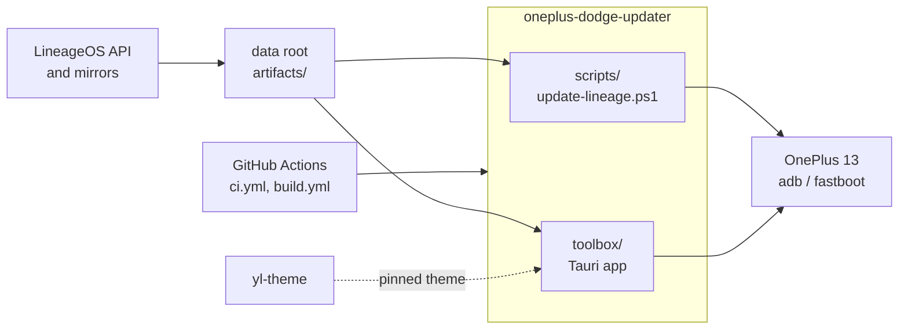

# oneplus-dodge-updater

[](https://github.com/AardeYamz/oneplus-dodge-updater/actions/workflows/ci.yml)
[](https://github.com/AardeYamz/oneplus-dodge-updater/actions/workflows/build.yml)


Keeps a [OnePlus 13](https://en.wikipedia.org/wiki/OnePlus_13) (CPH2655, `dodge`) on the latest LineageOS nightly with MindTheGapps, OrangeFox and KernelSU-Next, from a PowerShell script or **Dodge Toolbox**, a Windows app with one button per step.

> [!WARNING]
> Use at your own risk. This flashes firmware, and a wrong or interrupted flash can leave a phone unbootable or erase its data. It is written for one phone (CPH2655), and there are [open bugs](https://github.com/AardeYamz/oneplus-dodge-updater/issues?q=is%3Aissue+is%3Aopen+label%3Aaudit).

## Architecture



- **Flow:** pick the newest build, confirm, download and verify, sideload LineageOS, switch slot, sideload MindTheGapps, boot once, flash OrangeFox, then patch and flash `init_boot` (replaced by every update). Details in [docs/update-flow.md](docs/update-flow.md).
- **Safety:** flashing is refused unless exactly one device is attached and it is the dodge. Downloads are checked against the SHA-256 the LineageOS API publishes. The Toolbox's command box runs only a short list of `adb`/`fastboot` commands, and flashes only `recovery` and `init_boot`. A same-major update keeps data; back up before a major jump and check the [upgrade guide](https://wiki.lineageos.org/devices/dodge/upgrade/) for wipes.
- **Data root:** downloads and `platform-tools\` live in the repo root (gitignored), or wherever `DODGE_DATA_ROOT` in `.env` points (see `.env.example`).
- **Theme:** `build.rs` downloads the theme version (from theme.yannislam.org) pinned in `toolbox/theme.json` and checks each SHA-256. `DODGE_SKIP_THEME=1` skips it for offline compile checks.

## Layout

```
scripts/            update-lineage.ps1, build-toolbox.ps1, shared helpers and their tests
toolbox/            Tauri app: Rust in src/, page in ui/
.claude/skills/     Claude skill for running an update
docs/               update flow, audit findings
.github/            CI, build and Dependabot config
```

## Related repos

| Repo | Role |
|---|---|
| [workflows](https://github.com/AardeYamz/workflows) | shared CI workflows |

## Commands

Needs Windows, PowerShell, current [Platform-Tools](https://developer.android.com/tools/releases/platform-tools) on `PATH`, USB debugging and an unlocked bootloader. The Toolbox also needs [Rust](https://rustup.rs) (MSVC).

```powershell
Copy-Item .env.example .env                             # optional: set DODGE_DATA_ROOT
powershell -File scripts\update-lineage.ps1             # scripted update; -Build yyyyMMdd for a given nightly
cd toolbox; cargo run; cd ..                            # Toolbox in dev mode
pwsh scripts\build-toolbox.ps1                          # portable exe; -Fast, -BumpTheme
cargo test --manifest-path toolbox/Cargo.toml           # unit tests
pwsh scripts\test-helpers.ps1                           # script helper tests
```

Never run `fastboot -w`, `fastboot erase userdata` or "Format data" unless you mean to wipe the phone.

## Docs

- [docs/update-flow.md](docs/update-flow.md): the update step by step, using the Toolbox, flashing by hand and known issues.
- Script parameters and behaviour: `Get-Help .\scripts\update-lineage.ps1 -Full` (same for `build-toolbox.ps1`).
- [LineageOS dodge wiki](https://wiki.lineageos.org/devices/dodge/): [install](https://wiki.lineageos.org/devices/dodge/install/), [upgrade](https://wiki.lineageos.org/devices/dodge/upgrade/), [nightlies](https://download.lineageos.org/devices/dodge/builds).
- [docs/audit-findings-2026-11-09.md](docs/audit-findings-2026-11-09.md): audit work list.

## License

[MIT](LICENSE)
