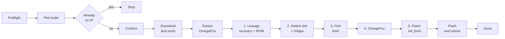

# dodge

Tooling and notes for keeping the OnePlus 13 (CPH2655, codename `dodge`) on the latest LineageOS nightly with MindTheGapps, OrangeFox and KernelSU-Next.

## Contents

```
docs/        flash-instructions.md (manual steps and notes)
scripts/     update-lineage.ps1 (scripted update), build-toolbox.ps1 (builds the exe)
toolbox/     Electron app that runs the update steps with a live log
artifacts/   downloads and flash images (gitignored; lives on X:\Android Development\Devices\Dodge, linked in)
  builds/<major>-<date>/   recovery.img, init_boot.img, build-manifest.xml
  lineage/ mindthegapps/ orangefox/ kernelsu-next/ pi-modules/   zips and APKs
  fox-extract/             unzipped OrangeFox recovery.img
  images/                  patched init_boot images, loose images
  archives/                other downloaded bundles
platform-tools/             adb / fastboot (gitignored; lives on X:\Android Development\Devices\Dodge)
```

## Quick start

```powershell
powershell -File scripts\update-lineage.ps1      # scripted update
cd toolbox; npm install; npm start               # or the toolbox app, one button per step
pwsh scripts\build-toolbox.ps1                   # build the portable exe
```

Prerequisites: Windows, PowerShell, `adb`/`fastboot` (platform-tools) on `PATH` (not the old Essential ADB 1.0.39, which fails on the 3 GB zip), USB debugging authorized, bootloader unlocked. Node.js 20+ for the toolbox.

A same-major update keeps data. Back up before a major jump (e.g. 24 -> 25).

## Update flow



| Step | What happens |
| --- | --- |
| Preflight | Checks `adb`/`fastboot` are on `PATH` and an authorized device is connected; reads the installed build and kernel. |
| Pick build | Queries the LineageOS API for the newest nightly (or `-Build`). Stops if the phone is already on it; warns on a major version change. |
| Confirm | Asks before anything is downloaded or flashed. |
| Download and verify | Fetches the ROM zip, `recovery.img`, `init_boot.img` and `build-manifest.xml`; checks the zip's SHA-256 and the `recovery.img` size. |
| Extract OrangeFox | Unzips OrangeFox's `recovery.img` into `fox-extract` and checks its size. |
| 1. Lineage recovery + ROM | Flashes LineageOS Recovery, then sideloads the ROM (tap **Apply from ADB** first). |
| 2. Switch slot + GApps | Reboots to recovery to land on the new slot, then sideloads MindTheGapps. |
| 3. First boot | Reboots to system once and waits for boot to complete. |
| 4. OrangeFox | Flashes the OrangeFox recovery (last, since the ROM zip can overwrite the recovery). |
| 5. Patch init_boot | Pushes the new `init_boot.img`; you patch it in KernelSU-Next with KMI `android15-6.6`; the script pulls it and checks `vermagic=` is 6.6.x. |
| Flash and reboot | Flashes the patched `init_boot`, reboots, and you confirm the manager says **Working**. |

`init_boot` is replaced on every update, so KernelSU-Next is re-patched each time.

## Scripts

### `scripts\update-lineage.ps1`

Scripted version of `docs\flash-instructions.md`. Steps that need a tap on the phone pause until you press Enter; the update and each wipe-risk step ask first.

| Parameter | Default | What it does |
| --- | --- | --- |
| `-Build` | newest nightly | Build date to install (`yyyyMMdd`), matched against the LineageOS API response. |
| `-DataRoot` | `$env:DODGE_DATA_ROOT`, then `DODGE_DATA_ROOT` in `.env`, then `X:\Android Development\Devices\Dodge` | Folder holding `artifacts\`. Throws if it does not exist. |
| `-Device` | `dodge` | LineageOS device codename used for the API and mirror URLs. |
| `-Gapps` | `<repo>\artifacts\mindthegapps\MindTheGapps-17.0.0-arm64-20261006_111038.zip` | MindTheGapps zip to sideload. |
| `-FoxZip` | `<repo>\artifacts\orangefox\OrangeFox-R12.0_2-dodge.zip` | OrangeFox zip; `recovery.img` is extracted to `artifacts\fox-extract`. |
| `-KsuPackage` | `com.rifsxd.ksunext` | KernelSU-Next manager package name shown in the on-phone prompt. |

Behavior:

- Stops if already on the target build; warns on a major version change.
- Downloads are skipped when the file already exists. The ROM zip is checked against the API SHA-256, and `recovery.img` must be exactly 104857600 bytes (same check for OrangeFox).
- Patched `init_boot` is saved as `artifacts\images\ksu-patched-init_boot-<date>.img` and rejected unless its `vermagic=` is 6.6.x.
- Rollback for root: `fastboot flash init_boot artifacts\builds\<major>-<date>\init_boot.img`.

### `scripts\build-toolbox.ps1`

Builds the portable Toolbox exe.

| Parameter | Default | What it does |
| --- | --- | --- |
| `-Store` | `X:\Android Development\Devices\Dodge` | Data store. Build output goes to `<Store>\toolbox-dist`; throws if the folder is missing. |

It runs `npm ci` if `node_modules` is missing, fetches the theme, runs electron-builder (portable, Windows), and copies `Dodge Toolbox <version>.exe` to the repo root. Keep the exe there so it finds `artifacts\` and `scripts\`.

### Configuration

Copy `.env.example` to `.env` (gitignored). Real environment variables win over the file.

| Variable | What it does |
| --- | --- |
| `DODGE_DATA_ROOT` | Where `artifacts\` and `platform-tools\` live. |
| `DODGE_PLATFORM_TOOLS` | Optional override for the platform-tools folder (default `<DODGE_DATA_ROOT>\platform-tools`). |

## Dodge Toolbox

An Electron app (Windows) that runs the same sequence one button at a time, with a live log.

```powershell
cd toolbox
npm install
npm start
```

The shared theme (`theme/yl-theme.css`, `theme/yl-theme.js`) is not committed. `npm start` and `npm run dist` first run `fetch-theme.js`, which downloads the version pinned in `theme.json` from https://theme.yannislam.org and checks its SHA-256 (needs a network connection the first time). `npm run theme` does it alone; `node fetch-theme.js --bump` pins the newest version. `theme/yl-fonts.css` is licensed and stays in the repo.

To build a single portable `.exe`: `npm run dist` (output in `toolbox\dist\`), or use `scripts\build-toolbox.ps1` as above. Set the working folder in Settings if the exe is not in the repo root.

Use:

1. Open **Settings** and check the platform-tools folder. The header shows the adb version and warns if the old Essential ADB (1.0.39) is in use.
2. Click **Refresh** to see the phone's state (`device`, `sideload`, `fastboot`...), build, kernel and slot.
3. Run the steps top to bottom. Yellow boxes say what to tap on the phone *before* clicking Run. Steps that reboot or flash ask first.

**Cancel** stops the running command, download or wait. **Quick actions** has reboot buttons, a box for one-off `adb`/`fastboot` commands, and a button that opens `scripts\update-lineage.ps1` in a PowerShell window. Wipe commands (`fastboot -w`, `erase userdata`, `format`, `wipe`) are refused in the command box.

Not yet run end to end against the phone.

## Docs

`docs\flash-instructions.md` has the manual sequence, KernelSU-Next details, Play Integrity results and known issues.
