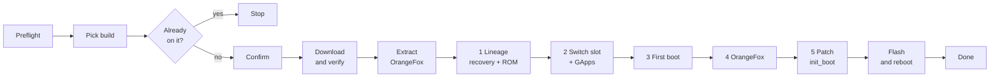

# oneplus-dodge-updater

Tooling and notes for keeping a [OnePlus 13](https://en.wikipedia.org/wiki/OnePlus_13) (CPH2655, codename `dodge`) on the latest LineageOS nightly with MindTheGapps, OrangeFox and KernelSU-Next. A same-major update keeps data; back up before a major jump (e.g. 24 to 25).

## Architecture

Two front ends run the same update sequence: a PowerShell script, and **Dodge Toolbox**, a Rust (Tauri) Windows app with one button per step and a live log.



| Path | What |
|---|---|
| `scripts/update-lineage.ps1` | the scripted update (the sequence above) |
| `scripts/build-toolbox.ps1` | builds the portable `dodge-toolbox.exe` |
| `toolbox/` | the Tauri app: Rust in `src/`, page in `ui/`, `build.rs` fetches the pinned theme |
| `artifacts/`, `platform-tools/` | downloads, flash images and adb/fastboot (git-ignored; point `DODGE_DATA_ROOT` at any drive) |
| `docs/` | audit findings |

Script options, Toolbox usage and manual flash instructions: [docs/reference.md](docs/reference.md).

## Related repos

| Repo | Relationship |
|---|---|
| [yl-theme](https://github.com/AardeYamz/yl-theme) | Pinned theme for the toolbox UI (`toolbox/theme.json`) |
| [personal-domain-devops](https://github.com/AardeYamz/personal-domain-devops) | Self-hosted runners that build and check it |
| [workflows](https://github.com/AardeYamz/workflows) | Shared CI |

## Quick start

Needs Windows, PowerShell and the latest [Android SDK Platform-Tools](https://developer.android.com/tools/releases/platform-tools) on `PATH` (old adb 1.0.39 can fail on the 3 GB sideload).

```powershell
powershell -File scripts\update-lineage.ps1   # scripted update
cd toolbox; cargo run                          # or the toolbox app
pwsh scripts\build-toolbox.ps1                 # portable exe
```

LineageOS docs for the device: [device page](https://wiki.lineageos.org/devices/dodge/), [install](https://wiki.lineageos.org/devices/dodge/install/), [upgrade](https://wiki.lineageos.org/devices/dodge/upgrade/), [nightlies](https://download.lineageos.org/devices/dodge/builds).
